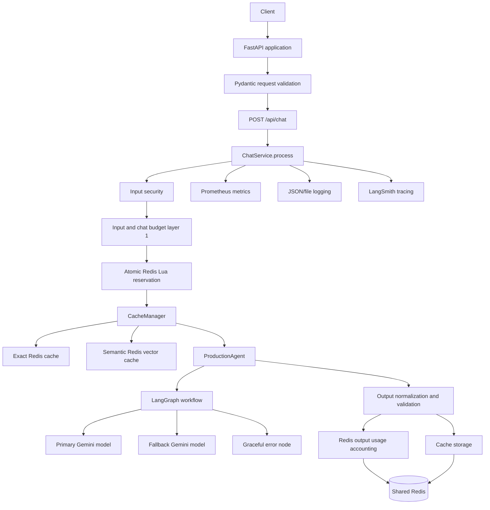
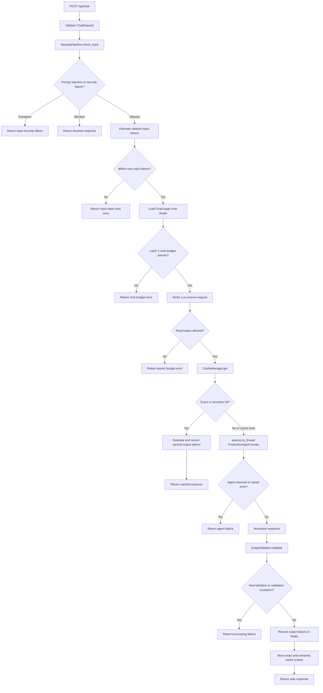
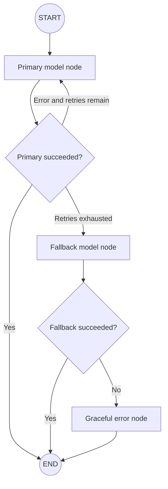

# Production RAG API: Technical Project Reference

This document is a code-grounded reference for the `production-api` project. It is written to give a future engineer or language model enough context to understand the architecture, request lifecycle, data contracts, operational dependencies, design rationale, and current implementation limits without having to rediscover the repository from scratch.

The most important distinction in this document is:

- **Implemented now** means behavior found in the executable Python code.
- **Intended or planned** means behavior described in comments, diagrams, or project notes but not fully wired into the running application.

When these differ, the implementation is authoritative.

## 1. Project Summary

`production-api` is a Python web API built with FastAPI. Its main use case is a production-oriented chat endpoint that places several controls around an LLM request:

1. Validate the HTTP request with Pydantic.
2. Detect prompt-injection patterns.
3. Clean input and mask personally identifiable information (PII).
4. Estimate input tokens and enforce per-request limits.
5. Read per-conversation usage from Redis.
6. Perform a first, non-atomic chat-budget check.
7. Perform a second, atomic Redis/Lua reservation to enforce limits safely across concurrent workers.
8. Look up an exact cache and then a semantic/vector cache.
9. Invoke a LangGraph agent on a cache miss.
10. Normalize and validate the generated response.
11. Record output-token usage in Redis.
12. Store the safe response in both cache layers.
13. Return a structured response containing the answer, security notes, cache information, model information, and errors when relevant.

The application is designed around asynchronous HTTP handling, shared Redis state, reusable application-level dependencies, Prometheus metrics, JSON/file logging, LangSmith tracing, and a primary/fallback LLM workflow.

The current LLM implementation uses `ChatGoogleGenerativeAI`. The repository contains RAG terminology and RAG-related metric definitions, but there is no complete retrieval service in the live request path yet. A cache miss currently goes to the agent directly.

## 2. High-Level Architecture



### Main runtime objects

The FastAPI lifespan creates and stores these objects in `app.state`:

- `SecurityPipeline`
- `CacheManager`
- `TokenBudget`
- `ChatUsageRepository`
- `ProductionAgent`
- `ChatService`

The `ChatService` receives those objects through constructor injection. Routes retrieve the service through `Depends(get_chat_service)` instead of constructing it for every request.

The metrics collector is a module-level singleton in `app/core/monitoring/metrics.py`, but lifespan does not currently put it into `app.state`. This creates a mismatch with the health dependency, which expects `request.app.state.metrics`.

## 3. Repository Layout

```text
production-api/
├── app/
│   ├── main.py                         FastAPI application creation and router registration
│   ├── api/
│   │   ├── router.py                   Aggregates API routers
│   │   ├── routes/
│   │   │   ├── chat.py                 POST /api/chat
│   │   │   ├── health.py               GET /api/health
│   │   │   └── metrics.py              GET /api/metrics
│   │   └── route_classes/
│   │       └── metrics_route.py        Custom route instrumentation for chat routes
│   ├── agents/
│   │   ├── agent.py                    ProductionAgent and LangGraph construction
│   │   ├── nodes.py                    Primary, fallback, and error node behavior
│   │   ├── routers.py                  Conditional graph routing
│   │   ├── state.py                    Typed LangGraph state
│   │   └── response_normalizer.py      Normalizes agent output
│   ├── core/
│   │   ├── config.py                   Pydantic settings and cached configuration
│   │   ├── lifespan.py                  Startup dependency construction
│   │   ├── cache/
│   │   │   ├── cache_manager.py        Exact-then-semantic cache orchestration
│   │   │   ├── exact_cache.py           SHA-256 exact-query cache
│   │   │   ├── semantic_cache.py        Gemini embeddings and Redis vector search
│   │   │   └── redis_operations.py      Redis text/vector operation wrapper
│   │   ├── monitoring/
│   │   │   ├── logging.py               JSON console and rotating file logging
│   │   │   └── metrics.py               Prometheus metrics collector
│   │   ├── observability/
│   │   │   └── observability.py         Observability integration surface
│   │   ├── redis/
│   │   │   └── redis_client.py          Shared async Redis clients and pools
│   │   ├── security/
│   │   │   ├── pipeline.py              Input/output security orchestration
│   │   │   ├── prompt_injection.py      Regex-based input sanitizer
│   │   │   ├── pii_masking.py            PII detection and redaction
│   │   │   └── output_validation.py      Output PII/harmful-content validation
│   │   └── token_budget/
│   │       ├── budget.py                 Stateless token rules and estimation
│   │       ├── chat_usage.py              Per-chat usage state model
│   │       ├── usage_repository.py       Redis persistence and atomic reservation
│   │       └── chat_usage.py              Usage data object
│   ├── dependencies/
│   │   └── services.py                  FastAPI dependency accessors
│   ├── exceptions/                      Exception module placeholders
│   ├── middleware/
│   │   └── chat_request/
│   │       └── request_middleware.py    Generic request metrics middleware
│   ├── models/
│   │   ├── requests.py                  ChatRequest
│   │   ├── responses.py                 ChatResponse, health, metrics models
│   │   └── error.py                     Error model surface
│   └── services/
│       ├── chat_service.py              Main business workflow
│       ├── llm_service.py               LLM service surface
│       └── rag_service.py               RAG service surface
├── docker/
│   ├── redis/docker-compose.yml         Redis 8 container and persistence
│   └── monitoring/                      Alloy/monitoring compose configuration
├── tests/                               Unit, integration-style, and exploratory tests
├── pyproject.toml                       Project metadata and dependencies
├── requirements.txt                     Dependency listing
├── project_flow.txt                     Detailed design notes and diagrams
├── trace_notes.txt                      Tracing notes
└── note.txt                             Miscellaneous project notes
```

## 4. Application Startup and Routing

### Entry point

The application is created in `app/main.py`:

- `FastAPI(title="Production RAG API", description="Production-ready RAG API", version="1.0.0")`
- The lifespan context is supplied from `app/core/lifespan.py`.
- The aggregate API router is mounted with the `/api` prefix.

Therefore the public paths are:

| Method | Path | Purpose |
|---|---|---|
| `POST` | `/api/chat` | Process a chat message |
| `GET` | `/api/health` | Basic health response |
| `GET` | `/api/metrics` | Prometheus exposition format |
| `GET` | `/docs` | FastAPI Swagger UI |
| `GET` | `/openapi.json` | Generated OpenAPI schema |

### Startup sequence

Before `yield`, lifespan performs the following:

1. Logs `Starting Production API`.
2. Creates `SecurityPipeline`.
3. Creates `CacheManager`.
4. Creates `TokenBudget`.
5. Creates `ChatUsageRepository`.
6. Creates `ProductionAgent`.
7. Creates `ChatService` with those dependencies.
8. Logs `Production API started successfully`.
9. Yields control while the server handles requests.

After `yield`, it logs shutdown completion. The current shutdown code does not explicitly close Redis clients or other external resources.

### Dependency injection

`app/dependencies/services.py` exposes accessors such as:

- `get_security_pipeline(request)`
- `get_cache_manager(request)`
- `get_metrics(request)`
- `get_token_budget(request)`
- `get_agent(request)`
- `get_chat_service(request)`

The chat route uses `get_chat_service`. The health route uses `get_metrics`, but lifespan does not currently set `app.state.metrics`; as written, health dependency resolution can fail with a missing state attribute.

## 5. HTTP Contracts

### Chat request

Defined by `ChatRequest` in `app/models/requests.py`:

```json
{
  "message": "What is retrieval augmented generation?",
  "thread_id": "chat-123"
}
```

Fields:

- `message`: required string, 1 to 10,000 characters.
- `thread_id`: required string, 1 to 100 characters. It identifies the conversation whose token usage is tracked.

Pydantic validation occurs before `ChatService.process()` runs. Invalid JSON or invalid field constraints produce FastAPI validation errors and never enter the service workflow.

### Chat response

Defined by `ChatResponse`:

```json
{
  "success": true,
  "response": "...",
  "cleaned_message": "...",
  "input_security_notes": [],
  "output_security_notes": [],
  "cached": false,
  "cache_type": null,
  "model_used": "primary",
  "error": null
}
```

Fields:

- `success`: whether the request produced an acceptable response.
- `response`: generated, cached, blocked, or null response depending on the branch.
- `cleaned_message`: sanitized input after prompt cleaning and PII masking.
- `input_security_notes`: notes such as PII categories masked.
- `output_security_notes`: output masking/blocking notes.
- `cached`: whether a cache response was used.
- `cache_type`: `exact`, `semantic`, or null.
- `model_used`: `primary`, `fallback`, or null.
- `error`: human-readable error description or null.

The service returns dictionaries and the route constructs `ChatResponse(**result)`, giving the response a final Pydantic validation pass.

## 6. Complete Chat Request Lifecycle

The controlling implementation is `ChatService.process()` in `app/services/chat_service.py`.



### Stage 1: Input security

`SecurityPipeline.check_input()` is synchronous because its current operations are local regex/string operations:

1. `InputSanitizer.check()` searches for prompt-injection patterns.
2. If a pattern matches, the pipeline returns `(False, "", [reason])` and the service stops.
3. If safe, `InputSanitizer.clean()` removes repeated delimiter characters and separates `{{`/`}}` markers.
4. `PIIDetector.detect()` identifies known PII categories.
5. If PII is found, `PIIDetector.mask()` replaces values with markers such as `[EMAIL]` and `[PHONE]`.
6. The service retains notes describing which categories were masked.

The cleaned value, rather than the original message, is used for token estimation, cache lookup, and agent invocation. This reduces the chance of sending or caching raw sensitive values.

Prompt-injection detection is pattern-based, not a complete security proof. Current patterns include variants of:

- Ignore or forget previous instructions.
- New instructions.
- System prompt.
- Prompt delimiters such as `--- end of prompt`.
- Pretend or act as another entity.
- Bypass restrictions.
- Reveal system instructions.
- Jailbreak/DAN language.

PII categories currently implemented:

- Email
- SSN
- Credit card
- IP address
- Phone number

### Stage 2: Per-request token budget

`TokenBudget.estimate_tokens()` is deliberately an approximation:

```text
estimated_tokens = max(1, int(number_of_words * 1.3))
```

Empty input is estimated as zero. Non-empty input is always at least one token.

`check_input()` compares the estimate with `token_max_input`. This protects the individual request before any shared usage reservation occurs.

### Stage 3: Chat usage layer 1

`ChatUsageRepository.get_usage(thread_id)` reads a Redis hash and reconstructs a `ChatUsage` object. The service then calls `TokenBudget.check_chat()`.

The chat-level rules are:

```text
current_total_tokens = total_input_tokens + total_output_tokens
projected_total = current_total_tokens + estimated_input_tokens
```

The request is rejected if either:

- `total_requests >= token_max_requests_per_chat`
- `projected_total > token_max_chat`

This check is useful for early rejection and normal control flow, but the read and decision are not atomic with the later update. It cannot by itself enforce limits under concurrent requests.

### Stage 4: Chat usage layer 2 and atomic reservation

`ChatUsageRepository.reserve_request()` executes a Lua script inside Redis. The script performs read, check, and update as one atomic Redis operation:

1. Read `total_input_tokens`, `total_output_tokens`, and `total_requests`.
2. Reject if the request count limit is reached.
3. Calculate current total tokens plus the new estimated input.
4. Reject if the chat token limit would be exceeded.
5. If allowed, increment `total_input_tokens` and `total_requests`.

The reservation happens before the LLM or cache operation. This is intentional: the input and request consumption is admitted before expensive work begins.

The atomic layer protects against this race:

```text
Worker A reads requests=49 -> allowed
Worker B reads requests=49 -> allowed
Worker A writes requests=50
Worker B writes requests=51
```

The Lua script prevents both workers from independently approving the same final capacity.

### Stage 5: Cache lookup

`CacheManager.get()` checks caches in this order:

1. Exact cache.
2. Semantic cache.
3. Cache miss.

Cache lookup latency and hit/miss metrics are recorded. If a cache lookup raises, `ChatService` treats the failure as a miss and continues to the agent. This is a fail-open design for availability: cache failure should not prevent answer generation.

### Stage 6: Cache hit accounting

A cache hit bypasses the agent. The service estimates the cached response output tokens and calls `record_output_usage()` so the chat usage still reflects the returned answer.

If output usage accounting fails after a cache hit, the response is still returned because it is already available. The failure is logged.

### Stage 7: Agent execution on cache miss

`ProductionAgent.invoke()` is synchronous because the underlying model invocation uses a blocking `.invoke()` call. The async service therefore runs it with:

```python
await asyncio.to_thread(self.agent.invoke, cleaned_message)
```

This keeps the event-loop thread available while the model call waits. `await` is still required because the service needs the completed result before it can validate, count, cache, and return it.

### Stage 8: Agent result handling

The agent returns a dictionary with:

```python
{
    "response": str,
    "model_used": "primary" | "fallback" | "unknown" | None,
    "error": str | None,
}
```

The service treats a non-null `error` as an agent failure and returns a structured unsuccessful response.

### Stage 9: Output normalization and security

The service calls `normalize_agent_response()` and then `SecurityPipeline.check_output()`.

Output validation:

1. Detects and masks PII in the model response.
2. Searches for configured harmful/sensitive patterns.
3. Replaces a blocked response with `Response blocked: potentially harmful content.`.
4. Returns cleaned text, notes, and an `is_safe` flag.

The current service records the output security metric, but the response path does not separately reject based on `is_output_safe`; the validator has already replaced harmful content with a blocked message.

### Stage 10: Output usage and cache storage

The cleaned response is token-estimated and recorded as `total_output_tokens` in Redis. The service then calls `CacheManager.set()` to store it in both exact and semantic caches.

Cache storage errors are logged and do not prevent returning the generated response. This is another fail-open availability decision.

## 7. Token Budget and Usage Model

### `ChatUsage`

`ChatUsage` is a dataclass representing one conversation’s state:

```python
@dataclass
class ChatUsage:
    total_input_tokens: int = 0
    total_output_tokens: int = 0
    total_requests: int = 0

    @property
    def total_tokens(self) -> int:
        return self.total_input_tokens + self.total_output_tokens
```

It contains state only. It does not enforce rules.

### `TokenBudget`

`TokenBudget` loads policy from settings and remains stateless. It owns:

- Input token maximum.
- Total chat token maximum.
- Requests-per-chat maximum.
- Token estimation.
- Non-atomic validation.
- In-memory usage mutation helper, although the service uses the Redis repository for actual persistence.

### `ChatUsageRepository`

The repository owns persistence and distributed concurrency:

- Redis reads reconstruct `ChatUsage`.
- Lua reserves input/request capacity atomically.
- Redis `HINCRBY` records output tokens afterward.

The repository does not hold authoritative state in Python memory. The shared Redis server is the authority across FastAPI workers.

A failed or cancelled request after reservation leaves input tokens and request count consumed but may not record output tokens. This is consistent with charging the request for admitted input/model resources, but it means the final accounting is intentionally asymmetric.

## 8. Redis Data Model

### Chat usage hash

Key format:

```text
token_usage:chat:<thread_id>
```

Example:

```text
token_usage:chat:chat-123
```

Hash fields:

```text
total_input_tokens   integer
 total_output_tokens  integer
total_requests       integer
```

### Exact cache

The exact cache normalizes a query with `lower().strip()`, hashes it using SHA-256, and builds:

```text
cache:exact:<sha256 hash>
```

The stored value is JSON:

```json
{
  "query": "original query",
  "response": "cached response"
}
```

The configured TTL is applied through Redis `SET(..., ex=ttl)`.

Exact-cache hit/miss counters are process-local and reset when the process restarts.

### Semantic cache

The semantic cache:

1. Generates a Gemini embedding.
2. Converts it to `float32` bytes with NumPy.
3. Stores a Redis hash under `cache:semantic:<random UUID>`.
4. Uses Redis vector search against `semantic_cache_idx`.

Conceptual hash fields:

```text
query       text
response    text
embedding   binary FLOAT32 vector
```

The semantic index is expected to be configured for vector search and a dimension matching the configured embedding dimension. The repository contains the intended `FT.CREATE` command in comments, but runtime startup does not create or verify the index.

Redis returns a cosine distance. The implementation treats a result as a hit when:

```text
distance <= semantic_cache_similarity_threshold
```

Despite the setting name, this is a distance threshold, not a similarity score threshold. A lower distance means a closer vector.

The semantic cache uses the binary Redis client because vector bytes must not be decoded as UTF-8. Exact/text operations use the text client with `decode_responses=True`.

Important current behavior: semantic search results may return `response` as bytes because the binary client is used, even though `SemanticCache.get()` declares `str | None`. This should be considered when diagnosing semantic-cache response or Pydantic serialization issues.

## 9. Redis Client and Docker

`RedisClient` creates two async Redis clients with separate connection pools:

- `redis`: text responses, `decode_responses=True`.
- `redis_binary`: binary-safe responses, `decode_responses=False`.

Both use settings for:

- Redis URL.
- Maximum connections.
- Socket timeout.
- Socket connect timeout.
- Health-check interval.

The Redis compose file uses Redis 8 Alpine, publishes port `6379`, enables AOF persistence, and uses a named data volume. It includes a ping health check.

Current resource-management gap: `RedisClient.close()` closes the text client but does not close `redis_binary`.

## 10. Production Agent

`ProductionAgent` combines LangChain model clients with LangGraph workflow control.

### LangChain versus LangGraph

- LangChain supplies model and integration components.
- LangGraph supplies the state machine that decides execution order, retries, fallback, and terminal behavior.
- LangSmith provides tracing around selected functions and agent invocation.

### Agent state

`AgentState` contains:

```python
{
    "messages": list[AnyMessage],
    "error": str | None,
    "retry_count": int,
    "model_used": str | None,
}
```

The `messages` field uses LangGraph’s `add_messages` reducer so node updates accumulate message history rather than blindly replacing it.

### Graph nodes and routes

Nodes:

- `process`: call the primary model.
- `fallback`: call the fallback model.
- `error`: create a graceful user-facing error message.

Graph shape:



Each actual model attempt records request and latency metrics. Errors record model/error-type metrics. If usage metadata is present on the model response, input/output token metrics are recorded.

The configured fallback model is currently not used in the constructor: `fallback_llm` is built with `self.settings.primary_model`, while the settings object also defines `fallback_model`. This is an implementation discrepancy worth knowing when reasoning about failover behavior.

The primary router uses `retry_count <= max_retries` after the node increments the count on failure. Depending on the intended interpretation of `max_retries`, this boundary can allow one additional primary attempt.

## 11. Security Model

Security is implemented as a pipeline rather than scattered route logic.

### Input security invariant

The LLM should receive the cleaned, masked message, not the raw request message. Cache keys and token estimates also use the cleaned value.

### Output security invariant

The client and caches should receive the cleaned output returned by `OutputValidator`, not raw model output.

### Limitations

The security controls are useful first-line defenses but are not comprehensive content moderation or prompt-injection prevention:

- Prompt detection uses a finite regex list.
- PII detection uses regexes and can produce false positives or false negatives.
- Harmful-output detection uses a small pattern list.
- There is no authentication/authorization implementation visible in the active route path.
- The authentication middleware directory exists, but the active wiring should be verified before assuming it protects endpoints.

## 12. Caching Policy

The cache manager uses a two-level lookup:

```text
cleaned query
    |
    +--> exact Redis cache
    |       +--> hit: return
    |       +--> miss
    |
    +--> semantic Redis vector cache
            +--> hit: return
            +--> miss: call agent
```

On a successful generated response, both cache stores are attempted. On a cache read error, the application calls the agent. On a cache write error, the application still returns the response.

The exact cache is deterministic and cheap. The semantic cache is more flexible but depends on:

- Gemini embedding credentials.
- A working embedding model.
- NumPy vector conversion.
- Redis Search/vector support.
- A correctly provisioned index.
- Correct binary response handling.

Semantic and exact cache statistics are local counters, not shared Redis metrics. They are not durable across worker restarts.

## 13. Observability

### Prometheus metrics

`app/core/monitoring/metrics.py` defines metric families for:

- Security checks.
- HTTP request count, status, errors, latency, and active requests.
- LLM request count, errors, latency, and input/output tokens.
- Token-limit violations.
- Cache results, errors, and latency.
- RAG requests, errors, and latency.

The metrics singleton is used directly by services and agent nodes. Metric-recording failures are generally caught and logged so observability failures do not break the business path.

`GET /api/metrics` returns `prometheus_client.generate_latest()` in Prometheus exposition format. The `MetricsResponse` Pydantic model is currently not used by this route.

Metrics are process-local unless Prometheus multiprocess collection is configured externally. No such multiprocess setup is visible in the repository.

### Request metrics

Chat routes use `MetricsAPIRoute`, which wraps the normal FastAPI route handler and records:

- Active request start/finish.
- Request latency.
- HTTP status.
- Request errors.

The endpoint label uses the route template, such as `/chat`, rather than a concrete URL value.

A generic `RequestMetricsMiddleware` also exists, but it is not registered in `app/main.py`. Therefore it does not currently instrument every route.

### Logging

The centralized logger creates:

- JSON console output.
- A rotating `logs/app.log` file.

Log fields include timestamp, level, message, logger, module, function, and line number. Service code commonly passes `extra={"extra_data": {...}}` to attach thread IDs, model names, cache types, token estimates, and failure reasons.

Current limitations include no explicit request ID, worker ID, or structured exception field, plus dependence on the process working directory for the log path.

### LangSmith tracing

`@traceable` is used on:

- Input security check.
- Output security check.
- Cache manager get/set.
- Production agent invocation.

The intended trace hierarchy is an API request containing security, cache, retrieval/agent, model, and output-security spans. The exact runtime hierarchy depends on LangSmith environment configuration and which functions are actually invoked.

## 14. Configuration

Settings are loaded by `pydantic-settings` from environment variables and `.env`, with unknown variables ignored. `get_settings()` is `@lru_cache`-decorated, so settings are loaded once per process.

### LLM and tracing

| Setting | Default/requirement | Meaning |
|---|---|---|
| `GEMINI_API_KEY` | Required | Gemini model and embedding credential |
| `PRIMARY_MODEL` | `gemini-3.6-flash` | Primary model name |
| `FALLBACK_MODEL` | `gemini-1.5-turbo` | Intended fallback model name |
| `LANGCHAIN_TRACING_V2` | `True` | LangSmith tracing toggle |
| `LANGCHAIN_API_KEY` | Required | LangSmith credential |
| `LANGCHAIN_PROJECT` | Required | LangSmith project name |

### Application and budget

| Setting | Default | Meaning |
|---|---:|---|
| `APP_ENV` | `development` | Environment label |
| `LOG_LEVEL` | `INFO` | Logging level |
| `RATE_LIMIT` | `20/minute` | Intended rate-limit policy |
| `CACHE_TTL_SECONDS` | `300` | Cache entry lifetime |
| `MAX_RETRIES` | `3` | Primary-agent retry setting |
| `TOKEN_MAX_INPUT` | `4000` | Maximum estimated input tokens per request |
| `TOKEN_MAX_CHAT` | `20000` | Maximum input plus output tokens per thread |
| `TOKEN_MAX_REQUESTS_PER_CHAT` | `50` | Maximum reserved requests per thread |

### Redis

| Setting | Default | Meaning |
|---|---:|---|
| `REDIS_URL` | `redis://localhost:6379/0` | Redis connection URL |
| `REDIS_MAX_CONNECTIONS` | `20` | Pool size limit |
| `REDIS_SOCKET_TIMEOUT` | `5.0` | Socket operation timeout |
| `REDIS_SOCKET_CONNECT_TIMEOUT` | `5.0` | Connection timeout |
| `REDIS_HEALTH_CHECK_INTERVAL` | `30` | Redis health-check interval |

### Embeddings and semantic cache

| Setting | Default | Meaning |
|---|---:|---|
| `EMBEDDING_MODEL` | `models/gemini-embedding-001` | Gemini embedding model |
| `EMBEDDING_DIMENSION` | `768` | Expected vector dimension |
| `SEMANTIC_CACHE_SIMILARITY_THRESHOLD` | `0.20` | Implemented cosine-distance cutoff |
| `SEMANTIC_CACHE_TOP_K` | `1` | Number of nearest results requested |

### Monitoring/Grafana

The settings contain `MONITORING_ENABLED`, `GRAFANA_OTLP_ENDPOINT`, `GRAFANA_INSTANCE_ID`, and `GRAFANA_API_KEY`. The monitoring compose/Alloy configuration uses differently named variables for Loki credentials, so deployment configuration should be checked before assuming Grafana ingestion works.

## 15. Running the Application

The project metadata targets Python `>=3.14`.

Typical local setup:

```powershell
uv sync
```

or install from the dependency file used by the environment:

```powershell
pip install -r requirements.txt
```

Start Redis using the repository compose file:

```powershell
docker compose -f docker/redis/docker-compose.yml up -d
```

Start the API:

```powershell
uvicorn app.main:app --reload
```

Useful URLs:

```text
http://localhost:8000/docs
http://localhost:8000/api/health
http://localhost:8000/api/metrics
```

Example request:

```powershell
$body = @{ message = 'What is RAG?'; thread_id = 'chat-123' } | ConvertTo-Json
Invoke-RestMethod -Method Post -Uri http://localhost:8000/api/chat -ContentType 'application/json' -Body $body
```

A working chat request also requires valid required environment values, especially Gemini and LangSmith credentials. Semantic-cache requests additionally require a compatible Redis vector index.

## 16. Testing Strategy and Current Test State

The repository contains tests for:

- API and health behavior.
- Settings.
- Agent graph behavior.
- Exact and semantic caches.
- Redis client and operations.
- Monitoring and logging.
- Prompt injection, PII detection, output validation, and the security pipeline.
- Chat-service security, cache, agent, and token-budget branches.
- Token budget and usage repository behavior.

The test suite is not uniformly structured. Important current characteristics:

- Some tests are executable scripts rather than normal pytest functions.
- Some async tests are not marked with `pytest.mark.asyncio`.
- `tests/test_health.py`, `tests/test_api.py`, and `tests/test_chat.py` are empty in the inspected repository.
- Some service tests use an older constructor or call signature and may not match the current `ChatService` requiring `thread_id`.
- Semantic-cache tests can require live Gemini credentials, Redis Search/vector support, a valid index, and external embedding calls.
- Redis tests may share live keys without complete isolation.
- Monitoring tests may execute work during module import instead of defining isolated tests.

For a reliable production test suite, prioritize isolated unit tests with mocked Redis/model clients, explicit async test support, deterministic settings overrides, and a small number of clearly marked integration tests for Docker Redis and real provider calls.

## 17. Current Implementation Gaps and Discrepancies

This section is intentionally explicit so future technical discussions do not treat design comments as completed functionality.

1. **RAG is not in the active chat path.** The service goes from cache miss to `ProductionAgent`; a complete retrieval pipeline is not visible in the request flow.
2. **Health dependency wiring is incomplete.** The health route calls `get_metrics()`, but lifespan does not assign `app.state.metrics`.
3. **Generic middleware is not registered.** `RequestMetricsMiddleware` exists but `main.py` does not add it.
4. **Redis shutdown is incomplete.** The binary Redis client is not closed by `RedisClient.close()`, and lifespan does not currently call close.
5. **Semantic index provisioning is not automated.** The expected index creation appears in comments, not startup/migration code.
6. **Semantic response type may be bytes.** Binary Redis operations can return byte strings for the cached response.
7. **Semantic threshold naming is misleading.** Code compares cosine distance with `<=`, while the setting name and comments discuss similarity.
8. **Fallback model configuration is disconnected.** The fallback client currently uses the primary model setting.
9. **Retry boundary may be off by one.** The router checks `retry_count <= max_retries` after incrementing failure count.
10. **Prometheus metrics are process-local.** Multi-worker aggregation is not configured in the repository.
11. **Metrics response model is unused.** `/api/metrics` returns raw Prometheus exposition instead of `MetricsResponse`.
12. **Exception hierarchy is mostly placeholders.** The app relies on generic exceptions and structured error dictionaries.
13. **Authentication/rate limiting are not confirmed as active.** Related folders/settings exist, but active application wiring must be verified separately.
14. **Monitoring environment names differ.** The application settings and Alloy/compose variables do not appear fully aligned.
15. **Secrets must be handled carefully.** Any checked-in environment file containing real credentials should be treated as exposed: rotate credentials, remove secrets from version control, and use a local ignored `.env` or deployment secret store.

## 18. Design Principles to Preserve

When extending this project, preserve these boundaries unless there is a strong reason to change them:

- Routes should translate HTTP to application calls; business orchestration belongs in services.
- `ChatService` should coordinate dependencies rather than create them.
- Security should happen before cache lookup and model invocation.
- Cache keys and model inputs should use the cleaned/masked message.
- Distributed usage admission must remain atomic in Redis.
- Output should be validated before caching or returning it.
- Blocking model calls should not run directly on the FastAPI event-loop thread.
- Cache and metrics failures should be handled according to their intended fail-open/fail-closed policy, not accidentally.
- Shared application objects should be initialized once per process during lifespan.
- Tests should distinguish pure unit logic from external-provider integration.

## 19. Mental Model for Future Changes

A useful way to reason about a change is to ask which boundary owns it:

| Concern | Owning module |
|---|---|
| HTTP schema and route | `app/api/routes` and `app/models` |
| Workflow orchestration | `app/services/chat_service.py` |
| Input/output security | `app/core/security` |
| Token policy | `app/core/token_budget/budget.py` |
| Per-thread distributed state | `app/core/token_budget/usage_repository.py` |
| Exact/semantic cache policy | `app/core/cache` |
| LLM workflow and retries | `app/agents` |
| Provider/environment settings | `app/core/config.py` |
| Redis connection lifecycle | `app/core/redis/redis_client.py` and lifespan |
| Metrics | `app/core/monitoring/metrics.py` |
| Logs | `app/core/monitoring/logging.py` |
| Startup construction | `app/core/lifespan.py` |

For example:

- A new prompt-injection rule belongs in the sanitizer, not in the route.
- A new per-chat limit belongs in settings, `TokenBudget`, and the atomic Redis reservation script.
- A new cache backend belongs behind `CacheManager` and its cache abstraction.
- A new model fallback policy belongs in the agent graph/router, not in `ChatService`.
- A new request-level metric should be added at the route/middleware boundary when possible, rather than duplicating timing code in every service.

## 20. Short End-to-End Explanation

A client posts a message and a thread ID. FastAPI validates both fields and passes the request to `ChatService`. The service rejects obvious prompt injection, masks PII, and estimates the cleaned input size. It checks the current thread usage, then asks Redis to atomically reserve the request and input tokens so concurrent workers cannot exceed the configured request or token ceilings.

The service then asks the cache manager for an exact match and, if needed, a semantically similar match. A hit is returned after output-token accounting. On a miss, the synchronous LangGraph agent runs in a worker thread. LangGraph retries the primary Gemini model, then tries the fallback path, and finally emits a graceful error if both paths fail. A successful response is normalized, checked for PII and configured harmful patterns, counted in Redis, stored in both caches, and returned with metadata describing the security, cache, and model decisions.

The core production idea is therefore:

```text
HTTP validation
  -> input security
  -> budget admission
  -> atomic distributed reservation
  -> cache acceleration
  -> resilient LLM workflow
  -> output security
  -> usage accounting
  -> cache population
  -> structured response
```
